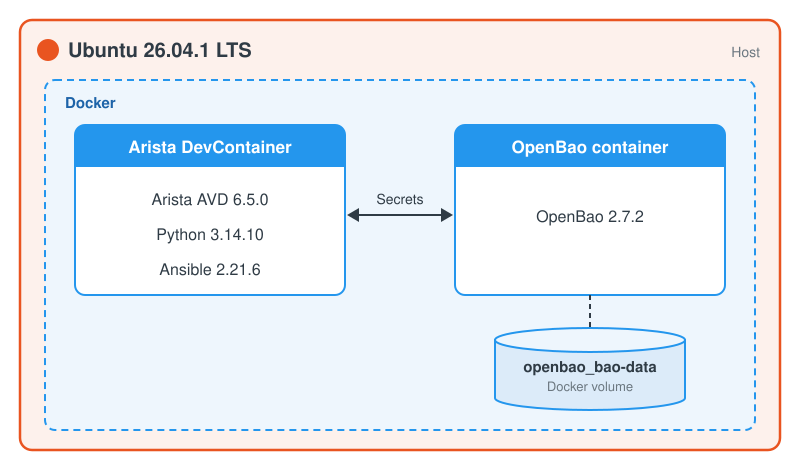

# AVD + OpenBao secrets demo

Three isolated environments (`net-prod`, `net-staging`, and `net-lab`), each with
three AVD datacenters. Each datacenter has two spines and two leaves. Secrets are
pulled at runtime from that environment's **OpenBao** mount; nothing sensitive is
stored in Git.



## Layout

| File | Purpose |
|---|---|
| `inventories/<environment>/inventory.yml` | One isolated inventory with `FABRIC` and `DC1`–`DC3` |
| `inventories/<environment>/group_vars/` | Environment's fabric settings, topology, and output directory |
| `global_vars/secret.yml` | Resolves environment-wide AAA and per-DC BGP secrets from OpenBao |
| `bao-secrets-template.yml` | Human-readable, single-environment Bao import template |
| `scripts/import-bao-secrets.py` | Imports non-null YAML values into that environment's KV v2 mount |
| `ansible.cfg` | Enables `arista.avd.global_vars`; inventory is always selected explicitly |
| `scripts/seed-openbao.sh` | Creates three environment mounts, secrets, policies, and AppRoles |

## OpenBao Paths

Each environment has its own KV v2 mount (`net-prod`, `net-staging`, `net-lab`).
Within each mount, `global/aaa` holds the environment's TACACS key and
`dc/dc1/bgp`, `dc/dc2/bgp`, and `dc/dc3/bgp` hold the corresponding BGP passwords.

## Usage

```bash
pip install "ansible-core<2.22" pyavd hvac netaddr PyYAML
ansible-galaxy collection install -r requirements.yml

# Configure Bao CLI authentication and ensure the selected KV v2 mount exists.
export BAO_ADDR=https://openbao.example.com:8200 BAO_TOKEN=<token-with-write-access>

# Import customer-provided secrets for one environment (update environment in the file if needed).
cp bao-secrets-template.yml bao-secrets-net-prod.yml
# Fill the file; populated bao-secrets-net-*.yml files are git-ignored.
python3 scripts/import-bao-secrets.py bao-secrets-net-prod.yml --dry-run
python3 scripts/import-bao-secrets.py bao-secrets-net-prod.yml

# The interactive seed script is an alternative for its supported secret subset.
# Do not run both import methods against the same paths.
# ./scripts/seed-openbao.sh

# Run (community.hashi_vault reads VAULT_* vars, not BAO_*)
export VAULT_ADDR=$BAO_ADDR
export VAULT_TOKEN=<token-with-avd-readonly>
#   or AppRole:
# export ANSIBLE_HASHI_VAULT_AUTH_METHOD=approle
# export ANSIBLE_HASHI_VAULT_ROLE_ID=... ANSIBLE_HASHI_VAULT_SECRET_ID=...

make build ENV=net-lab
make build ENV=net-staging
make build ENV=net-prod

ansible-playbook -i inventories/net-prod/inventory.yml playbooks/deploy.yml --ask-pass
```

## Notes

- Each build writes to that environment's `inventories/<environment>/intended/`
  and `inventories/<environment>/documentation/` directories. Type 7 is
  reversible, so generated output is git-ignored.
- Lookups are lazy: OpenBao is only queried when a value is rendered.
- Build one environment at a time; each can use separate OpenBao credentials and
  cannot accidentally mix its inventory with another environment.
